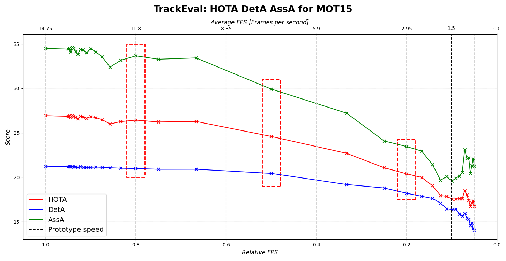
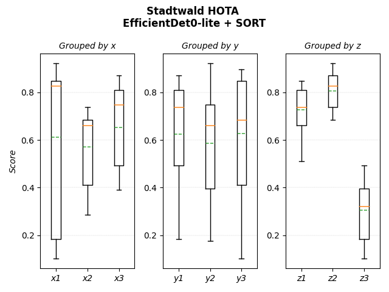

# Embedded, Privacy-Preserving People Counting

Code and results from my **Bachelor's thesis** *"Development and evaluation of an embedded AI-based, anonymous people counting system"* (B.Sc. Applied Computer Science, Heilbronn University, 2023, grade 1.7).

**Goal:** count people walking past a low-cost edge device (Raspberry Pi) without storing images. Only anonymous track IDs and line-crossing counts leave the device.

**Pipeline:** `camera frame → EfficientDet-Lite0 (TensorFlow Lite) → SORT tracker → virtual counting line → left/right counts`

## What this repository shows

1. **Inference pipeline:** EfficientDet-Lite0 person detection with TFLite, then multi-object tracking with SORT (Kalman filter + Hungarian matching), and directional counting when a track's centroid crosses the vertical centre line. The counter lives in `pipeline_for_videos.py`; it is commented out in the final state of the code, which was used for the HOTA runs.
2. **Benchmark evaluation on MOTChallenge:** tracking quality measured with **HOTA, DetA and AssA** (TrackEval) on MOT15 (also MOT16/17), with 9-fold cross-validation over sequences.
3. **Frame-rate reduction study:** edge hardware is slow, so I simulated lower frame rates by dropping frames. *How much tracking quality is lost when the device only processes every n-th frame?*
4. **Field evaluation ("Stadtwald"):** 27 staged scenes recorded with a factorial design. Each scene combines one level of three factors:
   - **x:** 1 person; 2 people in the same direction; 3 people in opposite directions
   - **y:** no turn; one person turns back before the line; one person turns back after the line
   - **z:** near / medium / far camera distance
5. **Counting metrics:** accuracy, precision, recall, F1, MAE and MSE of the predicted vs. true line crossings per direction.
6. **Raspberry Pi prototype:** live TFLite detection on the device (`raspberry-pi/`).

## Key results

**Frame-rate reduction (MOT15, EfficientDet-Lite0 + SORT)**



- HOTA stays almost constant (≈ 27 → 26) down to **~80 % of the original frame rate**. A moderate frame-rate reduction is nearly free.
- Below ~2/3 of the frame rate, association quality (AssA) drops steadily, because SORT's motion model loses track between frames that are far apart.
- The Raspberry Pi prototype ran at about **1.5 FPS**. At that rate the tracker operates in this degraded regime, which is the main bottleneck for deployment.

**Field scenes (Stadtwald, 27 sequences)**

| Metric | HOTA | DetA | AssA | DetPr | AssPr |
|---|---|---|---|---|---|
| EfficientDet-Lite0 + SORT | 66.4 | 63.4 | 69.6 | 93.7 | 92.6 |



**Camera distance is the dominant factor for tracking.** Near and medium distance reach a median HOTA of ~0.75–0.83, while far distance (z3) drops to ~0.3. Precision is high, so most errors are *missed* people rather than false detections. This argues for mounting the camera close to the passage or using a higher input resolution.

**Counting (Stadtwald, 27 sequences)**

On average, the running left/right counts match the ground truth in **92.2 % of frames** (macro F1 0.885, MAE 0.08 people). 19 of 27 scenes reach at least 97 % frame accuracy. Errors concentrate in scenes where **a person turns back after crossing the line (y3)**, especially at far distance (`x2_y3_z3`, `x3_y3_z3`). These failure cases point to the next step: track-level crossing logic with hysteresis instead of single-frame centroid crossings.

## Repository structure

```
code/
├── pipeline/
│   ├── pipeline.py                     # MOT benchmark pipeline incl. frame-rate reduction
│   ├── pipeline_for_videos.py          # pipeline for the field videos + line-crossing counter
│   ├── pipeline_utils.py               # GT re-indexing, seqinfo/seqmap generation, I/O helpers
│   ├── prepare_stadtwald_sequences.py  # builds MOT-style folders for the field sequences
│   └── sort.py                         # SORT tracker (third party, GPL-3.0, see below)
├── evaluation/
│   ├── evaluate_counting_metrics.py    # counting accuracy / precision / recall / F1 / MAE / MSE
│   ├── personcounting/                 # predicted running counts per scene
│   └── counting_*_detailed.csv         # per-scene counting metrics
└── visualization/                      # plots, 9-fold cross-validation, cached TrackEval outputs
figures/                                # final thesis figures
TrackEval_results/                      # TrackEval summaries per frame-rate setting
Stadtwald_data_for_pipeline/            # ground truth (MOT format) + seqinfo.ini per field scene
stadtwald_data_and_scripts/             # GT conversion scripts (MATLAB labeler → MOT) and counting GT
raspberry-pi/                           # on-device TFLite detection (Raspberry Pi OS, Python 3.7)
```

## Data that is *not* included

- **Field videos.** They show real people, so they are not published. Only bounding-box annotations and the resulting metrics are included.
- **MOTChallenge images.** Download MOT15/16/17 from [motchallenge.net](https://motchallenge.net) (CC BY-NC-SA 3.0) and place them in `code/MOT_data/<MOT15|MOT16|MOT17>/`.
- **Detector model.** Download [EfficientDet-Lite0 (TF Hub / Kaggle Models)](https://www.kaggle.com/models/tensorflow/efficientdet/tfLite/lite0-detection-default) and save it as `tflite-models/lite-model_efficientdet_lite0_detection_default_1.tflite`.

## Running it

```bash
pip install -r requirements.txt
python code/pipeline/pipeline.py          # MOT benchmark runs (writes TrackEval-ready folders)
python code/evaluation/evaluate_counting_metrics.py
```

HOTA metrics were computed with [TrackEval](https://github.com/JonathonLuiten/TrackEval) on the generated folders. This is thesis research code: paths are relative to the repository root and some settings are hard-coded in the `__main__` blocks.

## Tech stack

Python · TensorFlow Lite · OpenCV · NumPy · pandas · scikit-learn · FilterPy · Matplotlib · Raspberry Pi

## License

[GPL-3.0](LICENSE) © Tom Kraus. The repository includes the GPL-3.0 licensed SORT tracker, so the whole project is released under GPL-3.0.

## Third-party code

- `code/pipeline/sort.py`: [SORT](https://github.com/abewley/sort) by Alex Bewley, GPL-3.0
- `raspberry-pi/utils.py`: TensorFlow Lite example code by The TensorFlow Authors, Apache-2.0

See [THIRD_PARTY_NOTICES.md](THIRD_PARTY_NOTICES.md).
